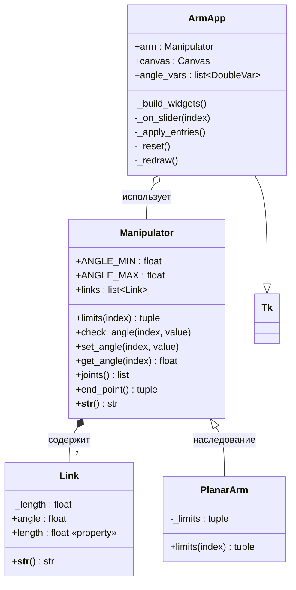

<div align="center">

МИНИСТЕРСТВО НАУКИ И ВЫСШЕГО ОБРАЗОВАНИЯ
РОССИЙСКОЙ ФЕДЕРАЦИИ

ФЕДЕРАЛЬНОЕ ГОСУДАРСТВЕННОЕ АВТОНОМНОЕ
ОБРАЗОВАТЕЛЬНОЕ УЧРЕЖДЕНИЕ ВЫСШЕГО ОБРАЗОВАНИЯ
«Омский государственный технический университет»

Кафедра «**Автоматизация и робототехника**»

<br><br>

**Отчет по лабораторной работе № 5**

по дисциплине «*Программирование на языке Python*»

<br><br>

</div>

Проверил
Доц., к.н. Ситников Д.В.
\_\_\_\_\_\_\_\_\_\_\_\_\_\_\_\_\_\_\_
подпись, дата

Разработал
Студент гр. УТС-251т
Аллагулов А.Р.
\_\_\_\_\_\_\_\_\_\_\_\_\_\_\_\_\_\_\_
подпись, дата

<div align="center">

Омск 2026

</div>

---

## 1. Цель работы

Изучение основ объектно-ориентированного программирования в Python (классы, инкапсуляция, наследование, полиморфизм) и получение практических навыков разработки настольного приложения с графическим интерфейсом на библиотеке Tkinter для моделирования и контроля мехатронного объекта.

## 2. Формулировка индивидуального задания (Вариант №1)

**Двухзвенный манипулятор.** Разработать приложение со следующим составом классов:

- `Link` — звено (длина, угол);
- `Manipulator` — манипулятор с двумя звеньями и методом прямой кинематики;
- `PlanarArm` — потомок `Manipulator` с ограничениями углов суставов.

Окно приложения: два ползунка углов, `Canvas` с изображением звеньев, вывод координат схвата. При выходе угла за допустимый предел выводится сообщение, а значение блокируется.

Дополнительные требования: свойство с проверкой значения (инкапсуляция), вызов `super()` (наследование), переопределённый метод (полиморфизм), метод `__str__`, отделение модели от интерфейса, не менее четырёх типов виджетов, обработка некорректного ввода через `try/except`, функция `main()`, docstring у классов.

Прямая кинематика (θ₂ отсчитывается от направления первого звена):

```text
x = L1·cos(θ1) + L2·cos(θ1 + θ2)
y = L1·sin(θ1) + L2·sin(θ1 + θ2)
```

Параметры модели: L1 = 1.5 м, L2 = 1.0 м; допустимые углы: сустав 1 — от −90° до 90°, сустав 2 — от −135° до 135°.

## 3. Диаграмма классов



Классы `Link`, `Manipulator` и `PlanarArm` находятся в модуле `arm_model.py` и не зависят от `tkinter`. Класс `ArmApp` (модуль `arm_app.py`) наследует `tk.Tk` и только вызывает методы модели и отображает её состояние.

**Реализация принципов ООП:**

- **Инкапсуляция:** длина звена `Link.length` задаётся через свойство с проверкой (`> 0`); углы суставов задаются через `set_angle()` после проверки `check_angle()`.
- **Наследование:** `PlanarArm` наследует `Manipulator` и вызывает `super().__init__()`.
- **Полиморфизм:** `PlanarArm` переопределяет метод `limits()`; метод `check_angle()` базового класса автоматически использует диапазон, соответствующий типу объекта.

## 4. Макет окна приложения и используемые виджеты

```text
┌──────────────────────────────┬──────────────────────────┐
│                              │ Углы суставов            │
│                              │  Сустав 1: [ползунок]    │
│        Canvas                │            [Entry]       │
│   (звенья, схват, оси)       │  Сустав 2: [ползунок]    │
│                              │            [Entry]       │
│                              │  [Применить] [Сброс]     │
│                              ├──────────────────────────┤
│                              │ Положение схвата         │
│                              │  x, y, θ1, θ2            │
│                              │  статус (Label)          │
└──────────────────────────────┴──────────────────────────┘
```

| Виджет | Назначение |
|---|---|
| `tk.Canvas` | изображение звеньев, суставов, схвата, осей и зоны досягаемости |
| `ttk.Scale` (×2) | задание углов суставов |
| `ttk.Entry` (×2) | ввод углов с клавиатуры |
| `ttk.Button` (×2) | «Применить значения из полей», «Сброс» |
| `ttk.Label` | вывод координат схвата, углов и статуса (зелёный/красный) |
| `ttk.LabelFrame` (×2) | группировка элементов управления и вывода |

Для связи виджетов с данными используются переменные `DoubleVar` (ползунки) и `StringVar` (поля ввода, метки). Окно использует менеджер размещения `grid()` для основной компоновки и `pack()` внутри рамок.

## 5. Листинг программы

**Файл модели `arm_model.py`:**

```python
"""Модель двухзвенного плоского манипулятора (без графического интерфейса)."""
import math


class Link:
    """Звено манипулятора: длина и угол поворота в суставе."""

    def __init__(self, length, angle=0.0):
        self._length = 1.0
        self.length = length          # проверка через свойство
        self.angle = float(angle)     # угол сустава, градусы

    @property
    def length(self):
        """Длина звена, м (только положительное значение)."""
        return self._length

    @length.setter
    def length(self, value):
        if value <= 0:
            raise ValueError("Длина звена должна быть положительной")
        self._length = float(value)

    def __str__(self):
        return f"звено(L={self._length:.2f} м, угол={self.angle:.1f}°)"


class Manipulator:
    """Двухзвенный манипулятор. Угол второго звена отсчитывается
    от направления первого. Допустимый диапазон углов — ±180°."""

    ANGLE_MIN = -180.0
    ANGLE_MAX = 180.0

    def __init__(self, length1=1.5, length2=1.0):
        self.links = [Link(length1), Link(length2)]

    def limits(self, index):
        """Допустимый диапазон угла сустава (переопределяется в потомках)."""
        return self.ANGLE_MIN, self.ANGLE_MAX

    def check_angle(self, index, value):
        """Проверка угла сустава; при выходе за предел — ValueError."""
        low, high = self.limits(index)
        if not low <= value <= high:
            raise ValueError(
                f"Сустав {index + 1}: угол {value:.1f}° вне диапазона "
                f"{low:.0f}...{high:.0f}°")

    def set_angle(self, index, value):
        """Задать угол сустава (после проверки)."""
        self.check_angle(index, value)
        self.links[index].angle = float(value)

    def get_angle(self, index):
        return self.links[index].angle

    def joints(self):
        """Прямая кинематика: координаты начала, сустава и схвата, м."""
        a1 = math.radians(self.links[0].angle)
        a2 = a1 + math.radians(self.links[1].angle)
        x1 = self.links[0].length * math.cos(a1)
        y1 = self.links[0].length * math.sin(a1)
        x2 = x1 + self.links[1].length * math.cos(a2)
        y2 = y1 + self.links[1].length * math.sin(a2)
        return [(0.0, 0.0), (x1, y1), (x2, y2)]

    def end_point(self):
        """Координаты схвата (x, y), м."""
        return self.joints()[-1]

    def __str__(self):
        x, y = self.end_point()
        return (f"{self.__class__.__name__}: θ1={self.links[0].angle:.1f}°, "
                f"θ2={self.links[1].angle:.1f}°, схват=({x:.3f}; {y:.3f}) м")


class PlanarArm(Manipulator):
    """Манипулятор с механическими ограничениями углов суставов."""

    def __init__(self, length1=1.5, length2=1.0,
                 limits=((-90.0, 90.0), (-135.0, 135.0))):
        super().__init__(length1, length2)
        self._limits = limits

    def limits(self, index):
        return self._limits[index]


if __name__ == "__main__":
    # Проверка модели без интерфейса
    arm = PlanarArm(1.5, 1.0)
    print(arm)
    arm.set_angle(0, 90)
    arm.set_angle(1, -90)
    print(arm)
    for idx, val in ((0, 120), (1, -150)):
        try:
            arm.set_angle(idx, val)
        except ValueError as err:
            print("Ошибка:", err)
    print(arm)
```

**Файл приложения `arm_app.py`:**

```python
"""Приложение «Двухзвенный манипулятор» (Tkinter)."""
import tkinter as tk
from tkinter import ttk, messagebox

from arm_model import PlanarArm


class ArmApp(tk.Tk):
    """Главное окно: ползунки/поля ввода углов, холст, вывод координат."""

    SIZE = 480      # размер холста, пикс.
    SCALE = 80      # пикселей на метр

    def __init__(self, arm):
        super().__init__()
        self.title("Двухзвенный манипулятор")
        self.resizable(False, False)
        self.arm = arm
        self._busy = False                      # защита от рекурсии
        self._warned = [False, False]           # предупреждение уже показано
        self.angle_vars = [tk.DoubleVar(value=0.0) for _ in range(2)]
        self.entry_vars = [tk.StringVar(value="0.0") for _ in range(2)]
        self.info = tk.StringVar()
        self.status = tk.StringVar(value="Углы в допустимых пределах")
        self._build_widgets()
        self._redraw()

    # ----- создание виджетов -----
    def _build_widgets(self):
        self.canvas = tk.Canvas(self, width=self.SIZE, height=self.SIZE,
                                bg="white")
        self.canvas.grid(row=0, column=0, rowspan=2, padx=5, pady=5)

        panel = ttk.LabelFrame(self, text="Углы суставов")
        panel.grid(row=0, column=1, sticky="n", padx=5, pady=5)
        for i in range(2):
            low, high = self.arm.limits(i)
            ttk.Label(panel, text=f"Сустав {i + 1}, ° "
                      f"(допустимо {low:.0f}...{high:.0f}):").pack(anchor="w")
            ttk.Scale(panel, from_=-180, to=180, length=220,
                      variable=self.angle_vars[i],
                      command=lambda _v, k=i: self._on_slider(k)
                      ).pack(fill="x", pady=2)
            ttk.Entry(panel, textvariable=self.entry_vars[i],
                      width=10).pack(anchor="w", pady=(0, 8))
        ttk.Button(panel, text="Применить значения из полей",
                   command=self._apply_entries).pack(fill="x", pady=2)
        ttk.Button(panel, text="Сброс (0°, 0°)",
                   command=self._reset).pack(fill="x", pady=2)

        out = ttk.LabelFrame(self, text="Положение схвата")
        out.grid(row=1, column=1, sticky="nsew", padx=5, pady=5)
        ttk.Label(out, textvariable=self.info, justify="left").pack(anchor="w")
        self.status_label = ttk.Label(out, textvariable=self.status,
                                      wraplength=240, foreground="green")
        self.status_label.pack(anchor="w", pady=(8, 0))

    # ----- обработчики событий -----
    def _ok(self, text="Углы в допустимых пределах"):
        self.status.set(text)
        self.status_label.config(foreground="green")

    def _fail(self, text):
        self.status.set(text)
        self.status_label.config(foreground="red")

    def _on_slider(self, index):
        """Перемещение ползунка: при выходе за предел значение блокируется."""
        if self._busy:
            return
        value = round(self.angle_vars[index].get(), 1)
        try:
            self.arm.set_angle(index, value)
        except ValueError as err:
            self._busy = True
            self.angle_vars[index].set(self.arm.get_angle(index))
            self._busy = False
            self._fail(str(err) + ". Значение заблокировано.")
            if not self._warned[index]:
                self._warned[index] = True
                messagebox.showwarning("Предел сустава", str(err))
        else:
            self._warned[index] = False
            self.entry_vars[index].set(f"{value:.1f}")
            self._ok()
        self._redraw()

    def _apply_entries(self):
        """Ввод углов с клавиатуры (с обработкой ошибок)."""
        try:
            values = [float(v.get().replace(",", ".")) for v in self.entry_vars]
            for i, val in enumerate(values):
                self.arm.check_angle(i, val)
        except ValueError as err:
            text = str(err)
            if text.startswith("could not convert"):
                text = "Введите числовые значения углов"
            self._fail(text)
            messagebox.showerror("Ошибка ввода", text)
            return
        for i, val in enumerate(values):
            self.arm.set_angle(i, val)
            self.angle_vars[i].set(val)
        self._ok()
        self._redraw()

    def _reset(self):
        for i in range(2):
            self.arm.set_angle(i, 0.0)
            self.angle_vars[i].set(0.0)
            self.entry_vars[i].set("0.0")
            self._warned[i] = False
        self._ok()
        self._redraw()

    # ----- отрисовка -----
    def _to_px(self, x, y):
        c = self.SIZE / 2
        return c + x * self.SCALE, c - y * self.SCALE

    def _redraw(self):
        cv = self.canvas
        cv.delete("all")
        c = self.SIZE / 2
        cv.create_line(0, c, self.SIZE, c, fill="#ccc")
        cv.create_line(c, 0, c, self.SIZE, fill="#ccc")
        reach = sum(link.length for link in self.arm.links) * self.SCALE
        cv.create_oval(c - reach, c - reach, c + reach, c + reach,
                       outline="#bbb", dash=(4, 4))
        pts = [self._to_px(*p) for p in self.arm.joints()]
        cv.create_line(*pts[0], *pts[1], width=8, fill="steelblue",
                       capstyle="round")
        cv.create_line(*pts[1], *pts[2], width=6, fill="darkorange",
                       capstyle="round")
        for px, py in pts[:2]:
            cv.create_oval(px - 7, py - 7, px + 7, py + 7,
                           fill="white", outline="black", width=2)
        gx, gy = pts[2]
        cv.create_rectangle(gx - 6, gy - 6, gx + 6, gy + 6,
                            fill="red", outline="black")
        x, y = self.arm.end_point()
        cv.create_text(gx + 10, gy - 14, anchor="w",
                       text=f"({x:.2f}; {y:.2f})")
        self.info.set(f"x = {x:.3f} м\ny = {y:.3f} м\n"
                      f"θ1 = {self.arm.get_angle(0):.1f}°\n"
                      f"θ2 = {self.arm.get_angle(1):.1f}°")


def main():
    arm = PlanarArm(1.5, 1.0)
    app = ArmApp(arm)
    app.mainloop()


if __name__ == "__main__":
    main()
```

## 6. Результаты работы

**Проверка модели без интерфейса (`python arm_model.py`):**

```text
PlanarArm: θ1=0.0°, θ2=0.0°, схват=(2.500; 0.000) м
PlanarArm: θ1=90.0°, θ2=-90.0°, схват=(1.000; 1.500) м
Ошибка: Сустав 1: угол 120.0° вне диапазона -90...90°
Ошибка: Сустав 2: угол -150.0° вне диапазона -135...135°
PlanarArm: θ1=90.0°, θ2=-90.0°, схват=(1.000; 1.500) м
```

Недопустимые углы отклонены, состояние манипулятора после ошибок не изменилось.

**Сценарий 1. Исходное положение (θ1 = 0°, θ2 = 0°):** манипулятор полностью вытянут вдоль оси X, схват находится в точке (2.500; 0.000) м, что равно сумме длин звеньев.


*Рисунок 1 — Исходное положение манипулятора*

**Сценарий 2. Штатный режим (θ1 = 45°, θ2 = −60°):** координаты схвата x = 2.027 м, y = 0.802 м совпадают с расчётом по формулам прямой кинематики.


*Рисунок 2 — Штатный режим работы*

**Сценарий 3. Граничные значения (θ1 = 90°, θ2 = 135°):** предельные значения допустимого диапазона принимаются без ошибки.


*Рисунок 3 — Углы на границах допустимого диапазона*

**Сценарий 4. Выход угла за предел (θ1 = 120°):** показывается предупреждение «Сустав 1: угол 120.0° вне диапазона −90...90°», ползунок возвращается к последнему допустимому значению (90°), положение манипулятора не меняется, в окне выводится красное сообщение о блокировке.


*Рисунок 4 — Блокировка недопустимого угла*

**Сценарий 5. Некорректный ввод в поле (`abc`):** программа не завершается аварийно, выводится сообщение «Введите числовые значения углов».


*Рисунок 5 — Обработка нечислового ввода*

## 7. Выводы

В ходе лабораторной работы разработано приложение с оконным интерфейсом на Tkinter для моделирования двухзвенного манипулятора. Логика модели (классы `Link`, `Manipulator`, `PlanarArm`) отделена от интерфейса (класс `ArmApp`) и проверена без графики в блоке `if __name__ == "__main__":`. Применены основные принципы ООП: инкапсуляция (свойство `length`, проверка углов в `set_angle()`), наследование с вызовом `super()` (`PlanarArm` от `Manipulator`) и полиморфизм (переопределённый метод `limits()`, используемый в `check_angle()`). Положение схвата вычисляется по формулам прямой кинематики и отображается на `Canvas` и в текстовых метках. Выход угла за допустимый предел и нечисловой ввод обрабатываются через `try/except`: пользователь получает сообщение, а значение блокируется, и программа продолжает работу. Полученные навыки позволяют строить событийно-управляемые приложения для контроля и моделирования мехатронных объектов.
